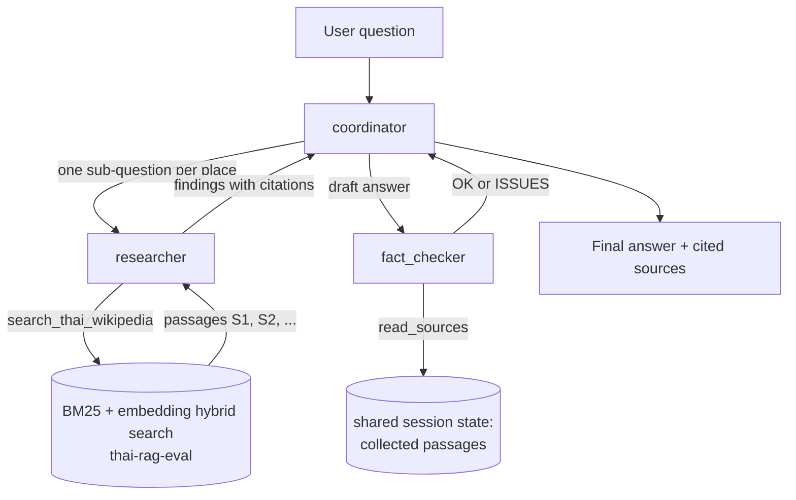
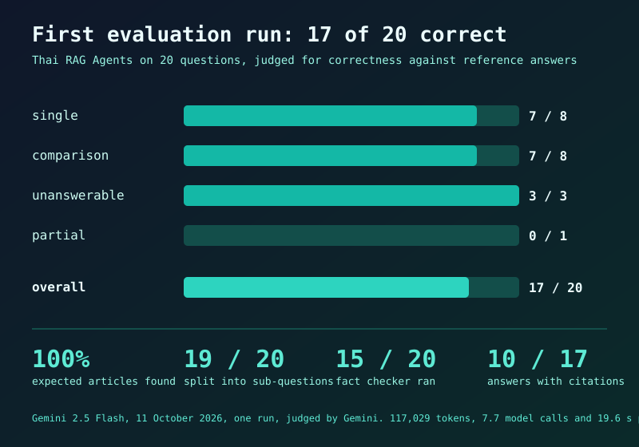
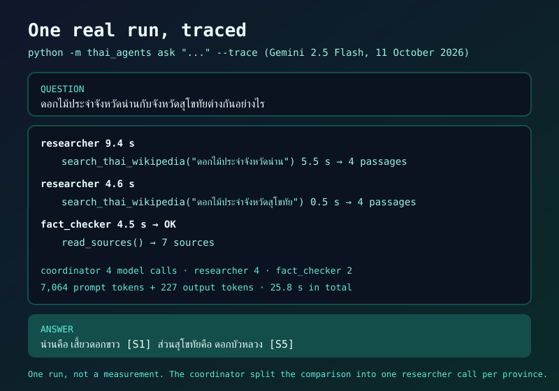

# Thai RAG agents

A small multi-agent system, built with Google's [Agent Development Kit](https://google.github.io/adk-docs/) (ADK), that answers questions about Thai provinces, temples, parks and landmarks from Thai Wikipedia. It reuses the hybrid search from [thai-rag-eval](https://github.com/WISHERCARTs/thai-rag-eval) as its only tool, and it comes with a trace of every call and an evaluation set.

> **Status:** the wiring, tools, tracing and evaluation code are covered by 54 tests that use scripted models (no API key needed). The 20-question evaluation has been run once against the real Gemini API: **17 of 20 answers were judged correct**. Read [the first run](#first-run-11-october-2026) before relying on that number: one miss is a reference problem, one is a real retrieval failure, and the faithfulness score is not reliable.

## What it does

Ask a question that needs more than one lookup, such as "Which is closer to Bangkok, Ayutthaya or Kanchanaburi?". A **coordinator** agent splits it into one sub-question per place, sends each to a **researcher** agent that searches the articles, writes a draft answer with citations like `[S1]`, and has a **fact checker** agent verify the draft against the passages that were found.



## Design decisions

| Decision | Why |
|---|---|
| Sub-agents are used as tools (`AgentTool`), not as hand-offs | A hand-off transfers control for good. As tools they return their result, so the coordinator can call the researcher several times, write the draft, then call the checker. |
| All agents share one list of sources in the ADK session state | The researcher writes passages with stable reference ids (`S1`, `S2`, ...); the fact checker reads exactly the same passages. This was checked first with a small experiment: state written by one agent-as-tool is visible to the next one. |
| The fact checker is a separate agent with its own instructions | It only sees the draft and the sources, not the researcher's reasoning, so it cannot talk itself into accepting a claim. |
| Tools return `{"status": "error", ...}` instead of raising | A failed search is reported to the researcher, which can retry or say "ไม่พบข้อมูลในเอกสาร", and the run goes on. |
| The agent module needs no API key or index at import time | `adk web` imports the module just to list agents. The index and the Gemini client load on the first search. |
| Tests use scripted models | A `ScriptedLlm` plays back a fixed sequence of text and tool calls, so delegation, shared state, tracing and failure handling are tested without any API call. |

## Tracing

`TracePlugin` is an ADK plugin that records every model call and tool call, including the calls an agent-as-tool makes inside itself, so the output reads as a call tree.

Example: one real run of `python -m thai_agents ask "ดอกไม้ประจำจังหวัดน่านกับจังหวัดสุโขทัยต่างกันอย่างไร" --trace` (Gemini 2.5 Flash, 11 October 2026):

```
น่าน: เสี้ยวดอกขาว [S1]   สุโขทัย: ดอกบัวหลวง [S5]

- researcher('ดอกไม้ประจำจังหวัดน่าน') 9.4s  -> ดอกไม้ประจำจังหวัดน่านคือ เสี้ยวดอกขาว [S1]
  - search_thai_wikipedia('ดอกไม้ประจำจังหวัดน่าน') 5.5s  -> 4 passages
- researcher('ดอกไม้ประจำจังหวัดสุโขทัย') 4.6s  -> ดอกไม้ประจำจังหวัดสุโขทัยคือ ดอกบัวหลวง [S5]
  - search_thai_wikipedia('ดอกไม้ประจำจังหวัดสุโขทัย') 0.5s  -> 4 passages
- fact_checker('...') 4.5s  -> OK
  - read_sources() 0.0s  -> 7 sources

model calls: coordinator 4, researcher 4, fact_checker 2 | 7,064 prompt + 227 output tokens | 25.8 s
```

The coordinator split the comparison into one researcher call per province, both answers match the article text, and the fact checker read all seven collected passages before replying OK. This is a single run, not a measurement: the first search was slow (5.5 s, which includes loading the index), and one run says nothing about how often the agents are right. That is what the evaluation below is for.

## Evaluation

[evals/cases.jsonl](evals/cases.jsonl) has 20 questions with reference answers taken from the articles, each checked against the corpus for contradicting values:

| Type | Count | What it tests |
|---|---|---|
| single | 8 | One fact from one article (a distance, an area, a provincial flower) |
| comparison | 8 | Two articles and a comparison or a subtraction. Needs two researcher calls. |
| unanswerable | 3 | Places or facts that are not in the corpus. The right answer is to refuse. |
| partial | 1 | One place is in the corpus, the other is not. Answer the first, refuse the second. |

Per question it scores: whether the right articles were retrieved (document recall), whether the answer is correct and faithful to the cited passages (judged by Gemini), whether comparison questions were split across enough researcher calls, whether the fact checker ran, citations that no search returned, errors, model calls and time.

Because every run costs Gemini calls, the command refuses to start without `--yes` and first prints an estimate (roughly 12 to 20 calls per question):

```bash
python -m thai_agents eval            # prints the estimate and exits, nothing is run
python -m thai_agents eval --yes      # runs it and writes evals/results/
```

### First run (11 October 2026)

All 20 questions, Gemini 2.5 Flash for the agents and for the judge, one run. Raw output is in [evals/results/2026-10-11-run1](evals/results/2026-10-11-run1).



| group | questions | correct | documents found | split into sub-questions | fact checker ran | avg model calls | avg seconds |
|---|---|---|---|---|---|---|---|
| single | 8 | 7 | 8 of 8 | 8 of 8 | 7 of 8 | 6.6 | 16.0 |
| comparison | 8 | 7 | 8 of 8 | 8 of 8 | 7 of 8 | 9.5 | 25.9 |
| unanswerable | 3 | 3 | – | 2 of 3 | 0 of 3 | 3.7 | 7.1 |
| partial | 1 | 0 | 1 of 1 | 1 of 1 | 1 of 1 | 13.0 | 35.8 |
| **all** | **20** | **17** | **17 of 17** | **19 of 20** | **15 of 20** | 7.7 | 19.6 |

The whole run used 117,029 tokens. The three unanswerable questions were refused (one without searching at all). All eight comparison questions were split into two researcher calls, one per place.

**What the three misses and the other numbers actually show**

- **s06, "how far is Nakhon Ratchasima from Bangkok" (reference 259 km): a reference problem, not a hallucination.** The article states 259 km in its introduction but also "about 256 km" in the road description and 264 km by train. The agent answered 256 km by road and 264 km by rail, both supported by the passages it found. The strict number rule counted it wrong, and I left the score as it was.
- **c07, Udon Thani vs Nong Khai (reference: Nong Khai is 51 km farther): a real failure.** The agent found Udon Thani's 564 km but reported that Nong Khai's distance was not in the documents, although the article says 615 km. Checking afterwards with keyword search alone, that passage ranks 2nd for a query worded "ห่างจากกรุงเทพมหานครกี่กิโลเมตร" but 27th, or not at all, for "ระยะทาง..." wordings, so the result depends on how the researcher phrased its query. This run did not save the queries, so the exact wording is unknown. Results now record them.
- **p01, Nan vs Yala (partial): borderline.** The agent gave Nan's area (11,472.07 km², the article says 11,472.076) and said Yala was not in the documents, which is the intended behaviour. It was judged wrong, probably by the exact-number rule. Counted as a miss.
- **Faithfulness (0.7) is not reliable and is left out of the table.** It is judged only for answers that cite sources (10 of 17), and one "unfaithful" verdict (c02) came from my own bug: the answer cited `[S1, S2]` and the parser read only single `[S1]` references, so the judge saw one source instead of two. The parser is fixed (and tested) but the saved results were not re-scored. The other two verdicts (c07, p01) were not examined.
- **Citations are often missing: only 10 of 17 answers cite a source, and 7 of the 8 single-fact answers have none.** The coordinator drops the `[S1]` on short answers although its instructions require it. Not fixed yet.
- **The fact checker was skipped on two answered questions (s06, c08)** even though the instructions say to run it. One of the two is the wrong answer above.



Next: tighten the instruction so short answers keep their citations and the checker always runs, re-run, and compare against this baseline.

Known limits: the same model family answers and judges; 20 questions and a single run is a small set with no measure of variance; the references come from Wikipedia text that can itself be inconsistent between sections (see s06).

## Run it

```bash
pip install -r requirements-dev.txt     # or: pip install -e ../thai-rag-eval && pip install google-adk pytest
pytest                                  # 54 tests, no API key needed

cp .env.example .env                    # add GEMINI_API_KEY
python -m thai_agents ask "ดอยอินทนนท์สูงกี่เมตร" --trace
adk web                                 # ADK's browser UI, run from the folder that contains thai_agents/
```

The agents search the saved index from thai-rag-eval. Build it there once with `python -m thairag ingest`, or point `THAIRAG_INDEX` at it.

## Layout

| Path | Contents |
|---|---|
| `thai_agents/agents.py` | The coordinator, researcher and fact checker and their instructions |
| `thai_agents/tools.py` | `search_thai_wikipedia` and `read_sources` (shared source list) |
| `thai_agents/retrieval.py` | Hybrid search over the thai-rag-eval index, loaded lazily |
| `thai_agents/trace.py` | The tracing plugin |
| `thai_agents/runner.py` | Runs one question and collects the answer, cited sources and trace |
| `thai_agents/evaluate.py`, `evals/` | Scoring and the question set |
| `tests/` | Scripted-model tests |

## Data

Answers come from Thai Wikipedia text (CC BY-SA 4.0), prepared in thai-rag-eval. See its `data/SOURCES.md`.
