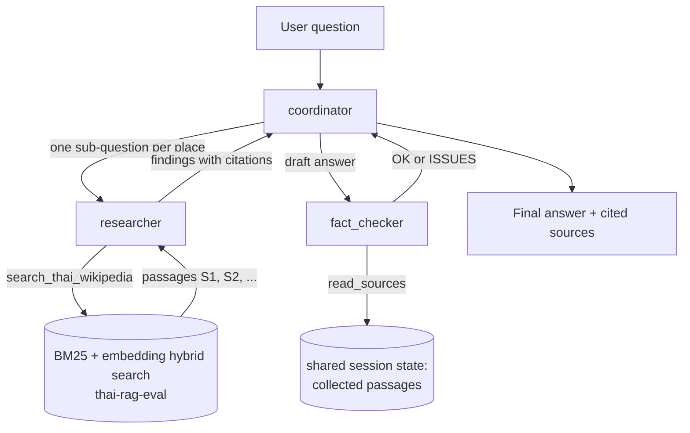

# Thai RAG agents

A small multi-agent system, built with Google's [Agent Development Kit](https://google.github.io/adk-docs/) (ADK), that answers questions about Thai provinces, temples, parks and landmarks from Thai Wikipedia. It reuses the hybrid search from [thai-rag-eval](https://github.com/WISHERCARTs/thai-rag-eval) as its only tool, and it comes with a trace of every call and an evaluation set.

> **Status:** the wiring, tools, tracing and evaluation code are covered by 46 tests that use scripted models (no API key needed). The agents have been run against the real Gemini API on **one question** (see the example below), and it behaved as designed. The 20-question evaluation has **not been run yet**, so there are no result numbers for it.

## What it does

Ask a question that needs more than one lookup, such as "Which is closer to Bangkok, Ayutthaya or Kanchanaburi?". A **coordinator** agent splits it into one sub-question per place, sends each to a **researcher** agent that searches the articles, writes a draft answer with citations like `[S1]`, and has a **fact checker** agent verify the draft against the passages that were found.



## Design decisions

| Decision | Why |
|---|---|
| Sub-agents are used as tools (`AgentTool`), not as hand-offs | A hand-off transfers control for good. As tools they return their result, so the coordinator can call the researcher several times, write the draft, then call the checker. |
| All agents share one list of sources in the ADK session state | The researcher writes passages with stable reference ids (`S1`, `S2`, ...); the fact checker reads exactly the same passages. This was checked first with a small experiment: state written by one agent-as-tool is visible to the next one. |
| The fact checker is a separate agent with its own instructions | It only sees the draft and the sources, not the researcher's reasoning, so it cannot talk itself into accepting a claim. |
| Tools return `{"status": "error", ...}` instead of raising | A failed search is reported to the researcher, which can retry or say "ไม่พบข้อมูลในเอกสาร", and the run goes on. |
| The agent module needs no API key or index at import time | `adk web` imports the module just to list agents. The index and the Gemini client load on the first search. |
| Tests use scripted models | A `ScriptedLlm` plays back a fixed sequence of text and tool calls, so delegation, shared state, tracing and failure handling are tested without any API call. |

## Tracing

`TracePlugin` is an ADK plugin that records every model call and tool call, including the calls an agent-as-tool makes inside itself, so the output reads as a call tree.

Example: one real run of `python -m thai_agents ask "ดอกไม้ประจำจังหวัดน่านกับจังหวัดสุโขทัยต่างกันอย่างไร" --trace` (Gemini 2.5 Flash, 11 October 2026):

```
น่าน: เสี้ยวดอกขาว [S1]   สุโขทัย: ดอกบัวหลวง [S5]

- researcher('ดอกไม้ประจำจังหวัดน่าน') 9.4s  -> ดอกไม้ประจำจังหวัดน่านคือ เสี้ยวดอกขาว [S1]
  - search_thai_wikipedia('ดอกไม้ประจำจังหวัดน่าน') 5.5s  -> 4 passages
- researcher('ดอกไม้ประจำจังหวัดสุโขทัย') 4.6s  -> ดอกไม้ประจำจังหวัดสุโขทัยคือ ดอกบัวหลวง [S5]
  - search_thai_wikipedia('ดอกไม้ประจำจังหวัดสุโขทัย') 0.5s  -> 4 passages
- fact_checker('...') 4.5s  -> OK
  - read_sources() 0.0s  -> 7 sources

model calls: coordinator 4, researcher 4, fact_checker 2 | 7,064 prompt + 227 output tokens | 25.8 s
```

The coordinator split the comparison into one researcher call per province, both answers match the article text, and the fact checker read all seven collected passages before replying OK. This is a single run, not a measurement: the first search was slow (5.5 s, which includes loading the index), and one run says nothing about how often the agents are right. That is what the evaluation below is for.

## Evaluation

[evals/cases.jsonl](evals/cases.jsonl) has 20 questions with reference answers taken from the articles, each checked against the corpus for contradicting values:

| Type | Count | What it tests |
|---|---|---|
| single | 8 | One fact from one article (a distance, an area, a provincial flower) |
| comparison | 8 | Two articles and a comparison or a subtraction. Needs two researcher calls. |
| unanswerable | 3 | Places or facts that are not in the corpus. The right answer is to refuse. |
| partial | 1 | One place is in the corpus, the other is not. Answer the first, refuse the second. |

Per question it scores: whether the right articles were retrieved (document recall), whether the answer is correct and faithful to the cited passages (judged by Gemini), whether comparison questions were split across enough researcher calls, whether the fact checker ran, citations that no search returned, errors, model calls and time.

Because every run costs Gemini calls, the command refuses to start without `--yes` and first prints an estimate (roughly 12 to 20 calls per question):

```bash
python -m thai_agents eval            # prints the estimate and exits, nothing is run
python -m thai_agents eval --yes      # runs it and writes evals/results/
```

Known limits: the same model family answers and judges; 20 questions is a small set; the references come from Wikipedia text that can itself be inconsistent between sections.

## Run it

```bash
pip install -r requirements-dev.txt     # or: pip install -e ../thai-rag-eval && pip install google-adk pytest
pytest                                  # 46 tests, no API key needed

cp .env.example .env                    # add GEMINI_API_KEY
python -m thai_agents ask "ดอยอินทนนท์สูงกี่เมตร" --trace
adk web                                 # ADK's browser UI, run from the folder that contains thai_agents/
```

The agents search the saved index from thai-rag-eval. Build it there once with `python -m thairag ingest`, or point `THAIRAG_INDEX` at it.

## Layout

| Path | Contents |
|---|---|
| `thai_agents/agents.py` | The coordinator, researcher and fact checker and their instructions |
| `thai_agents/tools.py` | `search_thai_wikipedia` and `read_sources` (shared source list) |
| `thai_agents/retrieval.py` | Hybrid search over the thai-rag-eval index, loaded lazily |
| `thai_agents/trace.py` | The tracing plugin |
| `thai_agents/runner.py` | Runs one question and collects the answer, cited sources and trace |
| `thai_agents/evaluate.py`, `evals/` | Scoring and the question set |
| `tests/` | Scripted-model tests |

## Data

Answers come from Thai Wikipedia text (CC BY-SA 4.0), prepared in thai-rag-eval. See its `data/SOURCES.md`.
